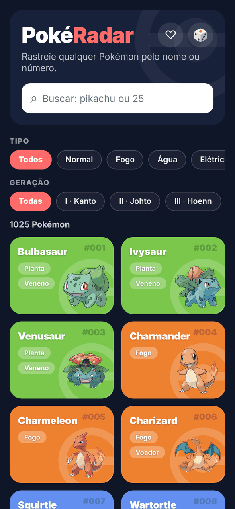
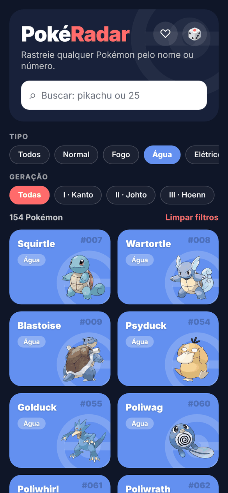
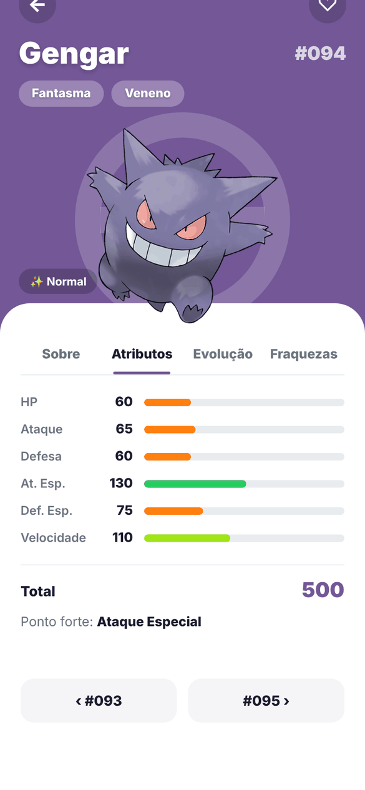
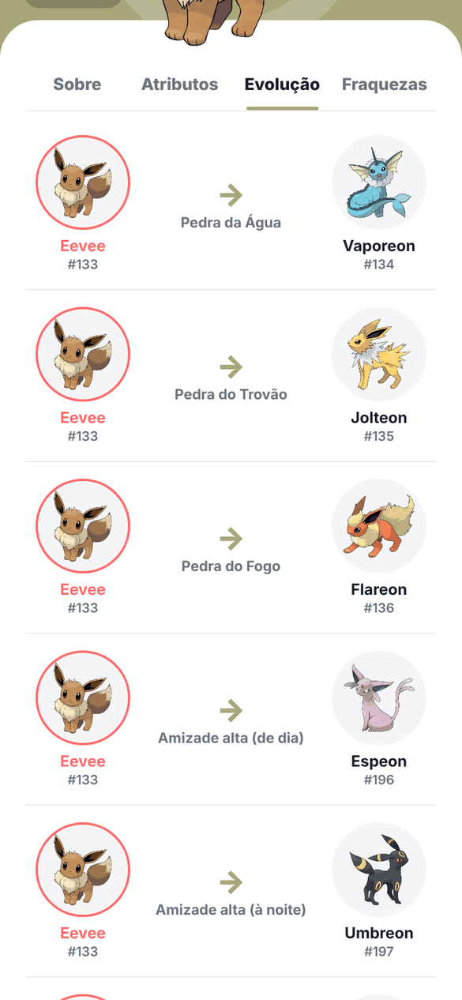
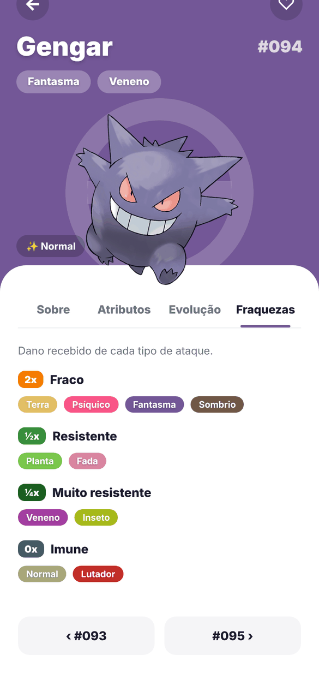

# PokéRadar

Pokédex feita em React Native com Expo, consumindo a [PokéAPI](https://pokeapi.co/).
Busque um Pokémon pelo nome ou pelo número da Pokédex e veja a arte oficial, os tipos, os atributos base e as habilidades.

## Telas

<table>
  <tr>
    <td align="center"><br><sub>Tela inicial</sub></td>
    <td align="center"><br><sub>Filtro por tipo e geração</sub></td>
    <td align="center"><br><sub>Detalhes com descrição em PT/EN</sub></td>
  </tr>
  <tr>
    <td align="center"><br><sub>Atributos base</sub></td>
    <td align="center"><br><sub>Cadeia de evolução</sub></td>
    <td align="center"><br><sub>Fraquezas e resistências</sub></td>
  </tr>
</table>

## Funcionalidades

**Tela inicial**
- Grade com todos os 1025 Pokémon, cada card com a cor do tipo principal, arte oficial e tipos
- Busca instantânea por nome ou número (ex.: `pikachu`, `25` ou `#025`)
- Filtro por tipo (18 tipos, traduzidos) e por geração/região (Kanto a Paldea)
- Favoritos salvos no aparelho, com filtro "só favoritos"
- Botão 🎲 que abre um Pokémon aleatório

**Tela de detalhes**
- Topo com a cor do tipo, Pokébola de marca d'água e imagem flutuando
- Alternância entre a arte normal e a shiny
- Selo de Lendário ou Mítico
- Aba **Sobre**: descrição da Pokédex em português ou inglês (botão PT/EN, a escolha fica salva), altura, peso, experiência base, habilidades (com a oculta marcada), geração, categoria, habitat, taxa de captura, grupos de ovo e proporção de gênero
- Aba **Atributos**: barras animadas em cascata, coloridas pelo valor, total e ponto forte
- Aba **Evolução**: cadeia completa com imagens e o método (nível, pedra, troca, amizade...), incluindo evoluções com vários caminhos, como a do Eevee. Toque em um Pokémon para abrir
- Aba **Fraquezas**: dano recebido de cada tipo (4x, 2x, ½x, ¼x e imune), calculado a partir da tabela de tipos
- Navegação para o Pokémon anterior e o próximo
- Mensagens de erro diferentes para "Pokémon não encontrado" e "sem conexão"

## Sobre as traduções

A PokéAPI não traz as descrições da Pokédex em português. Por isso, as descrições e categorias dos 1025 Pokémon foram traduzidas do inglês com o auxílio de IA e ficam salvas no próprio app, em `src/data/pokedexTexts.js`. O texto original em inglês continua disponível pelo botão **PT/EN**.

## Tecnologias

- React Native com Expo SDK 58
- React Navigation (native stack)
- Axios
- AsyncStorage (favoritos e idioma)
- PokéAPI

## Estrutura

```
App.js                        # navegação e provedor de favoritos
src/
  theme.js                    # cores, tipos, gerações e traduções
  services/pokeapi.js         # chamadas à PokéAPI
  context/FavoritesContext.js # favoritos salvos no aparelho
  context/LanguageContext.js  # idioma da descrição (PT/EN)
  data/pokedexTexts.js        # descrições e categorias em PT e EN
  utils/
    format.js                 # formatação de nomes e números
    typeChart.js              # tabela de efetividade de tipos
  components/
    PokemonCard.js            # card da grade
    TypeBadge.js              # etiqueta de tipo
    StatBar.js                # barra de atributo
    EvolutionChain.js         # cadeia de evolução
    TypeDefenses.js           # fraquezas e resistências
    Pokeball.js               # Pokébola de marca d'água
  screens/
    HomeScreen.js             # grade, busca e filtros
    DetailsScreen.js          # detalhes com abas
docs/screenshots/             # imagens usadas neste README
```

## Como rodar

```bash
npm install
npx expo start
```

Depois, escaneie o QR code com o app Expo Go no celular ou aperte:

- `a` para Android
- `i` para iOS
- `w` para Web
